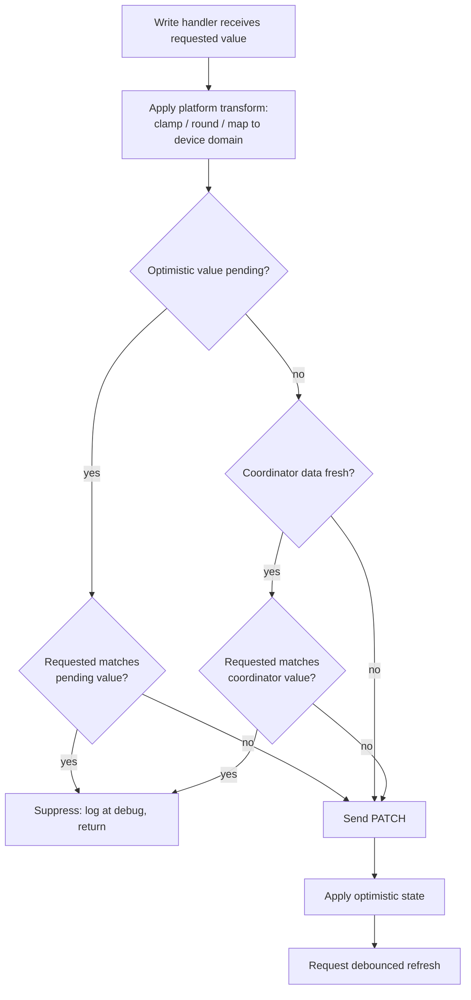

# No-op write suppression and write-path error handling - Plan

## Goal Capsule

- **Objective:** Stop the integration from sending `PATCH /settings` requests that rewrite a value the charger already holds, surface write failures as Home Assistant error types, and give the lifetime energy sensor the state class documented for never-resetting totals.
- **Authority hierarchy:** This plan's Key Technical Decisions override implementer preference. Existing conventions in `custom_components/ecovolter/entity.py` override this plan where they conflict on style. Home Assistant's documented entity contracts override both.
- **Execution profile:** Three independent units, no shared state between them. U1 carries the behavioral risk; U2 and U3 are contained.
- **Stop conditions:** Stop and surface a blocker if suppression cannot reuse the existing optimistic comparison hooks without changing their semantics, or if switching the energy sensor's state class turns out to require a statistics migration beyond a one-time repair acknowledgement.
- **Tail ownership:** Quality gates in Verification Contract run per unit. Field validation of the central hypothesis is the user's, not the implementer's — see Open Questions.

---

## Product Contract

### Summary

Suppress settings writes whose value already matches the charger's known state, raise Home Assistant error types from the three write platforms, and correct the lifetime energy sensor's state class. The first change is a candidate fix for real charging interruptions; the other two remove log noise and unblock `continue_on_error` in the user's automation.

### Problem Frame

On 25 July 2026 charging was interrupted three times — 12:00:55, 12:06:34 and 13:56:12 local. Each time the charger's session energy counter reset to zero and all three phase currents dropped together (5.7/5.8/5.6 A to 0.2/0.2/0.2 A), recovering to the same values roughly 30 seconds later. The vehicle stayed connected throughout, `temperature_current_limit` read 0 A all day, and three-phase mode was active continuously. That signature is a contactor drop and session teardown, not a current reduction, a thermal derate, or a phase switch.

Each interruption coincides with a `PATCH /settings` request timing out — three automation aborts, first at 12:00:10, last at 13:56:10. The setpoint was unchanged across the whole window at 6 A, the configured minimum, so every one of those writes was rewriting a value the charger already had. Before v1.0.0 the user ran the charger unmanaged, issuing no writes at all, and never saw an interruption. The leading hypothesis is that the firmware re-applies the current limit unconditionally and cycles the contactor doing so, even when the requested value has not changed.

Causality cannot be established from Home Assistant data. A write holding `_request_lock` in `custom_components/ecovolter/api.py` blocks the poll queued behind it, so the 24 seconds in which the contactor actually opened are unobservable. Suppressing writes that cannot change anything is worth doing on its own terms; whether it removes the interruptions is a field question.

Two smaller defects surfaced alongside. Write failures raise `EcovolterApiClientCommunicationError`, which is not a `HomeAssistantError` — so HA classifies it as an unexpected error, prints a full traceback, and `continue_on_error: true` cannot suppress it. And `totalChargedEnergy` is declared `TOTAL_INCREASING`, a state class documented for counters that reset to zero and climb again, when it is a lifetime total.

### Requirements

**Write suppression**

- R1. A settings write whose requested value already matches the charger's known value is not sent to the device.
- R2. Suppression does not apply when coordinator data is not fresh, so a setting the device silently dropped is still re-asserted.
- R3. A suppressed write leaves optimistic state and refresh scheduling untouched, and is recorded at debug level.

**Write error surfacing**

- R4. A failed settings write raises a Home Assistant error type, so HA logs one categorized line rather than an unexpected-exception traceback.
- R5. Write error messages resolve through the integration's string catalogue in both English and Czech.
- R6. An authentication failure during a write starts Home Assistant's reauthentication flow.

**Energy statistics**

- R7. The lifetime charged-energy sensor declares the state class documented for never-resetting totals, so a device-side counter dip no longer produces a monotonicity warning.

### Success Criteria

- No `PATCH /settings` request is issued while the automation is holding a setting at an unchanged value.
- A write failure produces a single-line HA error, and `continue_on_error: true` on the automation's write step lets the run continue.
- The recorder no longer logs a `total_increasing` monotonicity warning for the charged-energy sensor.

### Scope Boundaries

**Not in scope**

- Write retries of any kind. If a timed-out PATCH actually applied — which the evidence suggests — a retry requests a second contactor cycle and interrupts charging again. This is contraindicated, not merely unnecessary.
- Best-effort writes that swallow errors. The user is diagnosing device firmware and must not lose the failure signal.
- Charger network configuration, including moving `base_uri` to a static IP. That is a config-entry change the user makes, not code.
- The user's Home Assistant automation. Adding `continue_on_error: true` to its write steps is a companion action outside this repo.
- A charging-session interruption detector. The user already learns about interruptions from the vehicle, and correctly noted that a correct detector would need `isCharging` as well as `isVehicleConnected`, since current can legitimately be zero on a connected car.

**Deferred to follow-up work**

- `totalChargingTime` and `totalChargingCount` carry the same `TOTAL_INCREASING` class and the same lifetime-counter semantics as `totalChargedEnergy`, but have shown no backward movement. Revisit if either warns.
- If field observation shows suppression did not stop the interruptions, the next step is vendor firmware follow-up, not further integration hardening.

### Sources

- `docs/plans/2026-06-28-001-feat-charger-resilience-and-optimistic-updates-plan.md` — the completed v1.0.0 work this builds on. Its Phase 3 established the optimistic comparison hooks U1 reuses, and it deliberately left writes non-tolerant.
- Home Assistant developer docs, sensor entity — state class selection: `TOTAL` without `last_reset` for values that never reset, `TOTAL_INCREASING` for values that reset to zero and only increase. Also documents that a `total_increasing` decrease under 10% does not start a new meter cycle, which is why the observed 0.07 kWh dip on 1905 kWh never corrupted statistics: <https://developers.home-assistant.io/docs/core/entity/sensor/>
- Home Assistant integration quality scale, `action-exceptions` and `exception-translations` rules — communication failures from entity methods raise `HomeAssistantError`, with messages carried by translation keys in `strings.json`.

---

## Planning Contract

### Key Technical Decisions

- KTD1. **Compare against the pending optimistic value when one is set, otherwise the coordinator value.** A repeat write during the optimistic window must compare against what was last sent, not against device data that has not caught up yet — otherwise the second write in a burst is always transmitted. The optimistic value is the integration's own record of what it sent, so its freshness is not in question and the R2 gate does not apply to that branch.
- KTD2. **Gate device-value comparison on `coordinator.data_is_fresh`.** While tolerated-stale data is being served, the coordinator's values may predate a device-side change, so suppression must not fire. This reuses the freshness property added in v1.0.0 for exactly this class of decision.
- KTD3. **Reuse `_device_value()` and `_values_match()` from `OptimisticEcovolterEntity` rather than writing new comparison logic.** Those hooks already express per-platform value-domain comparison — bool for switch, int for select, float with a 0.005 tolerance for number. A parallel comparison path would drift from them.
- KTD4. **In the number platform, compare the post-transform value.** Clamping and rounding happen before the write; a request of 40 A that clamps to 32 A must be compared as 32, matching what optimistic state stores.
- KTD5. **Map communication failures to `HomeAssistantError` and authentication failures to `ConfigEntryAuthFailed`.** `ConfigEntryAuthFailed` subclasses `HomeAssistantError`, so the single-line logging and `continue_on_error` behavior hold for both, while auth failures additionally start reauthentication.
- KTD6. **Correct the energy sensor's state class rather than clamping its value.** Clamping would add last-highest-value tracking to the sensor to prop up a state class the HA docs assign to cycle counters. `TOTAL` is the documented choice for a lifetime total and needs no state.
- KTD7. **No retry on write failure.** Recorded as a decision because it is counterintuitive: the evidence suggests a timed-out PATCH was applied, so retrying would request a second contactor cycle.

### High-Level Technical Design

The write-path gate that U1 introduces, sitting between the service call and the existing PATCH:

The suppression branch returns before all three of PATCH, optimistic state, and refresh scheduling — nothing changed, so nothing needs reflecting or reading back.

### Sequencing

The three units have no functional dependencies and can land in any order. Land U1 before U2 anyway: both edit the same three write handlers, and doing suppression first means the error-mapping wrapper is added once around a handler whose shape has settled. U3 touches only `custom_components/ecovolter/sensor.py` and is independent of both.

### Assumptions

- The charger reports its current settings accurately in `GET /settings`. If it reports 6 A while actually applying something else, suppression would leave the discrepancy in place. The `data_is_fresh` gate bounds staleness but does not detect a lying device.
- Home Assistant's `number` component continues to validate against `native_min_value`/`native_max_value` before invoking the entity method, so out-of-range values never reach the write path. The existing clamp in the number platform remains the guard for the direct-call path that `tests/test_optimistic.py` exercises.

---

## Implementation Units

### U1. Suppress no-op settings writes

**Goal:** No `PATCH /settings` request is sent when the requested value already matches the charger's known value.

**Requirements:** R1, R2, R3

**Dependencies:** none

**Files:**
- `custom_components/ecovolter/entity.py` — shared suppression predicate on `OptimisticEcovolterEntity`
- `custom_components/ecovolter/number.py` — `async_set_native_value`
- `custom_components/ecovolter/switch.py` — `async_turn_on`, `async_turn_off`
- `custom_components/ecovolter/select.py` — `async_select_option`
- `tests/test_no_op_writes.py` — new

**Approach:** Add a predicate to `OptimisticEcovolterEntity` that answers whether a given device-domain value is already in effect, following the KTD1/KTD2 branch order in the High-Level Technical Design. It delegates comparison to the existing `_values_match()` and reads device state through the existing `_device_value()`, so each platform's value domain is honored without new per-platform logic.

Each write handler consults the predicate after applying its own transform and before calling `async_set_settings`. On a match it logs at debug and returns, skipping the PATCH, `_apply_optimistic()`, and `async_request_refresh()`.

The existing hooks already behave correctly when the coordinator has no value for a key: the number platform's `_values_match` returns `False` for `None`, and the default equality comparison in the mixin returns `False` when comparing a real value against `None`. Both mean "not a no-op", so a missing key results in the write being sent.

**Execution note:** The proof here is unusually crisp — the fake client's `set_calls` list either grew or it did not. Write the "records no call" assertions before the predicate exists; they pin the contract more precisely than prose can, and a passing suppression test against an unimplemented predicate would expose a wiring mistake immediately.

**Patterns to follow:** The comparison contract in `custom_components/ecovolter/entity.py` — optimistic values are stored and compared in the raw device domain, with display mapping confined to each platform's value property. The suppression predicate stays in that domain.

**Test scenarios:**
- Writing `targetCurrent` at its current fixture value of 10 records no call in `set_calls`, and the entity state is unchanged.
- Writing `targetCurrent` at 12 records exactly one call carrying 12.
- Turning on a switch that is already on records no call; turning on a switch that is off records one.
- Selecting the currency already active records no call; selecting a different currency records one.
- Writing `kwhPrice` at a value differing from the device by less than the 0.005 tolerance records no call; writing a value differing by more than the tolerance records one.
- A repeat write of the same value while an unconfirmed optimistic value is pending records no second call, and the pending optimistic value and its expiry are left untouched.
- A write of a *different* value while an optimistic value is pending is sent, and overwrites both optimistic value and expiry.
- With the coordinator in tolerated-failure state (`last_update_success` true, `data_is_fresh` false) and no optimistic value pending, a write matching the last-known device value is still sent.
- Requesting `targetCurrent` above the charger maximum, where the clamped result equals the current device value, records no call — the comparison happens after the clamp.
- A key absent from the coordinator's settings is written rather than suppressed.
- A suppressed write emits a debug-level record naming the entity and the value that was already in effect, captured via `caplog` at debug level. This is the only assertion covering R3's logging half; without it the debug record is unverified.

**Verification:** `set_calls` on the fake client is the direct evidence — the suppression scenarios must show it unchanged, and the send scenarios must show exactly one new entry with the expected payload. All existing tests in `tests/test_optimistic.py` still pass, since every write they perform changes a value.

### U2. Raise Home Assistant error types from the write paths

**Goal:** A failed write logs as one categorized line, and `continue_on_error` becomes usable in the caller's automation.

**Requirements:** R4, R5, R6

**Dependencies:** none — independent of U1, though both touch the same three write handlers

**Files:**
- `custom_components/ecovolter/number.py`, `custom_components/ecovolter/switch.py`, `custom_components/ecovolter/select.py` — write handlers
- `custom_components/ecovolter/strings.json` — new `exceptions` block alongside the existing `config` and `entity` blocks
- `custom_components/ecovolter/translations/en.json`, `custom_components/ecovolter/translations/cs.json` — mirrored messages
- `tests/test_write_errors.py` — new
- `tests/test_optimistic.py` — `test_patch_failure_sets_no_optimistic` currently asserts `pytest.raises(EcovolterApiClientCommunicationError)` and must be updated to the new type

**Approach:** Wrap the `async_set_settings` call in each write handler. Catch `EcovolterApiClientAuthenticationError` and re-raise `ConfigEntryAuthFailed`; catch the remaining `EcovolterApiClientError` and re-raise `HomeAssistantError` carrying `translation_domain` and a translation key, chained from the original so the cause survives in debug logs. The existing behavior of not setting optimistic state on failure is preserved — the re-raise happens before `_apply_optimistic()` is reached.

Also replace the bare `ValueError` raised for an unsupported currency option in the select platform with `ServiceValidationError`. It is the same convention fix in the same handler: HA logs validation errors at debug rather than as unexpected exceptions, because the fault is the caller's input.

**Patterns to follow:** The `exceptions` block shape and `translation_domain`/`translation_key` usage from HA's `exception-translations` quality-scale rule. Mirror the nesting style already used by the `config.error` block in `strings.json`.

**Test scenarios:**
- A write whose client call raises a communication error raises `HomeAssistantError` out of the service call, and the entity falls back to coordinator state with no optimistic value set.
- A write whose client call raises an authentication error raises `ConfigEntryAuthFailed`.
- The raised error's message resolves through the translation catalogue rather than appearing as an untranslated key.
- Selecting an unsupported currency option raises `ServiceValidationError`.
- Every translation key referenced by the write handlers exists in `strings.json`, `translations/en.json`, and `translations/cs.json`, with no key present in one file and missing from another.

**Verification:** Hassfest validation in CI checks translation completeness and will fail on a key present in `strings.json` but absent from a translation file. The updated `tests/test_optimistic.py` failure test passes against the new exception type.

### U3. Correct the lifetime energy sensor's state class

**Goal:** The charged-energy total is declared as a never-resetting lifetime total, so a device-side dip no longer trips the recorder's monotonicity check.

**Requirements:** R7

**Dependencies:** none

**Files:**
- `custom_components/ecovolter/sensor.py` — the `totalChargedEnergy` entity description
- `tests/test_sensor_statistics.py` — new

**Approach:** Change the `totalChargedEnergy` description's `state_class` from `SensorStateClass.TOTAL_INCREASING` to `SensorStateClass.TOTAL`, leaving `device_class`, unit, and display precision alone. Do not set `last_reset` — the HA docs assign `TOTAL` without `last_reset` to values that never reset, which is what a lifetime charged-energy counter is.

Nothing else changes. The sensor keeps reporting the device value verbatim; no clamping, no retained maximum. Sibling counters `totalChargingTime` and `totalChargingCount` stay as they are — see Scope Boundaries.

**Test scenarios:**
- The charged-energy sensor's reported state class attribute is `total`.
- Feeding a decreasing sequence of device values (1905.34 then 1905.27, matching the observed dip) leaves the sensor reporting each value verbatim, with no exception raised.
- The device class remains `energy` and the unit remains kWh, so Energy dashboard eligibility is preserved.

**Verification:** The state class attribute assertion is the primary signal. On a live install the recorder's monotonicity warning for this entity stops appearing, because the `warn_dip` call sits inside a `TOTAL_INCREASING`-only branch of the sum compiler. Existing long-term statistics carry over with no repair prompt and no user action — see Risks.

---

## Verification Contract

| Gate | Command | Applies to |
|---|---|---|
| Type check, integration | `mypy custom_components/ecovolter` | U1, U2, U3 |
| Type check, tests | `mypy tests` | U1, U2, U3 |
| Lint | `ruff check .` | U1, U2, U3 |
| Tests | `pytest tests -v --maxfail=1 --disable-warnings` | U1, U2, U3 |
| Translation and manifest validation | Hassfest and HACS validation jobs in `.github/workflows/check_and_test.yaml` | U2 |

Field observation, which the quality gates cannot cover: with U1 deployed, `set_calls`-equivalent behavior on the real charger means no PATCH is logged while the ecological automation holds current at minimum. Whether charging interruptions stop is a multi-session observation, tracked in Open Questions.

---

## Definition of Done

**Global**

- All Verification Contract gates pass.
- No retry logic was introduced on any write path.
- Abandoned or experimental code from approaches that did not pan out is removed, not left in the diff.
- `tests/test_optimistic.py` passes unmodified except for the exception-type update named in U2.

**Per unit**

- U1. A write matching current device state records no client call; a write of a changed value records exactly one. Suppression does not fire while data is stale.
- U2. Write failures raise `HomeAssistantError` or `ConfigEntryAuthFailed`; every referenced translation key exists in all three catalogue files.
- U3. The charged-energy sensor reports state class `total` and accepts a decreasing value sequence without error.

---

## Risks & Dependencies

- **A genuine device counter reset will move the statistics sum backwards.** With `TOTAL` and no `last_reset`, Home Assistant recognises a reset only when `last_reset` changes, so a real counter reset on the charger (factory reset, counter replacement) is read as a large negative delta rather than a new meter cycle. `TOTAL_INCREASING` would have absorbed it. Rare for a lifetime counter, and the remedy is a manual adjustment in Developer Tools → Statistics. Accepted as the cost of the correct state class.

  This transition needs no statistics migration: `DEFAULT_STATISTICS` in `components/sensor/recorder.py` maps both `TOTAL` and `TOTAL_INCREASING` to the same statistic types and mean type, so the stored metadata is unchanged, and none of the six statistics validation issues can fire on it.
- **Suppression assumes the charger reports its settings honestly.** If the device echoes a value it is not actually applying, suppression removes the corrective rewrite that currently masks it. The `data_is_fresh` gate bounds staleness but cannot detect a lying device. Considered acceptable: the alternative is rewriting every value on every automation tick, which is the behavior under investigation.
- **The central hypothesis may be wrong.** Suppression is justified on its own merits — writes that cannot change anything should not be sent to a fragile single-connection device — but it may not stop the interruptions. The plan does not depend on the hypothesis being correct.
- **An existing test asserts the old exception type.** `test_patch_failure_sets_no_optimistic` in `tests/test_optimistic.py` will fail once U2 lands unless updated in the same change.

---

## System-Wide Impact

- **All three write platforms change together.** Number, switch and select share the suppression predicate and the error-mapping shape, so partial application would leave inconsistent behavior across writable entities.
- **The exception contract that automations observe changes.** Any automation currently relying on a write failure surfacing as an unexpected error will instead see a `HomeAssistantError`. This is the intended effect — it is what makes `continue_on_error` work — but it is an observable behavior change for callers.
- **One sensor's long-term statistics semantics change.** Scoped to `totalChargedEnergy`; no other entity's statistics are touched.
- **Device load drops.** With the ecological automation holding a value, PATCH traffic goes from roughly one request per automation tick to zero, which also removes the corresponding `_request_lock` contention that currently delays polls behind a hanging write.

---

## Open Questions

- Whether suppressing no-op writes eliminates the charging interruptions. Resolvable only by observing several charging sessions after deployment; the 1:1 correlation between write timeouts and session resets is suggestive but not causal, because the request lock makes the relevant window unobservable. **Deferred, not blocking** — the change stands on its own rationale, and the answer determines whether follow-up moves to vendor firmware escalation.
